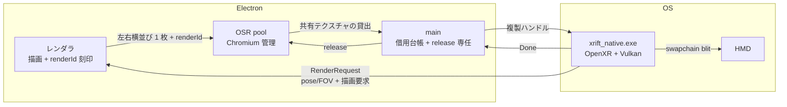

# アーキテクチャ

Electron（OSR）で描いたページを、CPU コピーを経ずに HMD に出す構成である。

## 経路

1. exe が pose/FOV と描画要求（`RenderRequest`）を発行し、接続世代・空間世代・描画 ID を変更不能なレコードとして保持する（`native/src/transfer/render_record.h`）。
2. レンダラは要求された record を描き、実際に使った record の ID を画像の予約領域（制御ブロック）に描く。描画コールバックを呼び終えた後に overlay canvas へ描くため、painted 画像の内容とタグは同一 record に対応する。rAF を呼ばなかった record では更新しない（`client/src/shim.ts`）。
3. main は OSR `paint` の共有テクスチャを借用台帳に登録し、NT ハンドルを transfer-addon（`DuplicateHandle` のみ。GPU 操作なし）で exe プロセスへ複製して Offer する（`client/src/main.ts`、`native/transfer-addon/addon.cpp`）。
4. exe は Vulkan で外部メモリ import し、自前リングイメージへ GPU コピーする。コピー後の同一画像から制御ブロックを GPU で検査し、renderId/pose タグを保持レコードと照合する。不明 ID・checksum 不一致・失効・space 世代不一致・年齢超過は破棄する（`native/src/transfer/shared_texture.cpp`、`native/src/ipc/control_blocks.h`）。
5. 受理画像だけを左右に分離して XR swapchain へ blit し、`xrEndFrame` で提出する。main は提出に関与しない。

## 借用の所有権と release 遅延

- OSR テクスチャと pool の所有者は Electron/Chromium である。`release()` を呼ぶのは main プロセスだけであり、1 借用 1 回に限る。
- レンダラは描画内容と renderId の整合性に責任を持ち、返却は担当しない。exe は借用中の複製だけ扱い、所有権は取らない。
- 台帳は接続世代と借用 ID で管理し、renderId とは分離する（同じ描画の複数 paint は別の借用）。
- 転送前 drop は即返却できる。転送後は consumer の GPU アクセスが全て終わった証拠（Done の GPU 完了確認）が来るまで main の独断で返却しない。
- 返却条件は GPU 完了の証拠であり、timeout・IPC 切断・プロセス終了通知は代用にならない。期限超過による返却は禁止する。
- 完了を確認できない・device lost・所有不明の借用は `release()` せず隔離（quarantine）する。旧 producer 世代を停止・隔離し、次回は新しい session/connection epoch・pool・HANDLE で開始し、旧 ACK・旧画像を受け付けない。

## record TTL

- 描画レコードには年齢上限（`--record-ttl-ms`）がある。exe 単体の既定は 500ms だが、app 経由の通常運用は `--record-ttl-ms=2000` で渡す。実測で本番サイトに 350〜500ms の遅延があるためである（`client/src/main.ts` の `RECORD_TTL_MS` 既定 2000）。
- TTL を超えた record 由来の画像は失効として棄却する。

## 再提出

- 最後に受理した画像は exe 所有の hold イメージへ GPU 複製する。新規受理が無いフレームでも、同じ record の pose/FOV のまま出し直す（再提出）。黒フレームより古い絵を優先する。
- 最新 pose への付け替えは禁止する。対応不明の画像を再投影頼みで提出することも禁止する。
- 最初の 1 枚が来る前だけ projection layer なしで frame を終える。

## pace（フロー制御）

- exe は未処理の Offer がある間は新しいレコードを発行しない。Offer を処理（受理/棄却）し終えたら次のフレームで発行する。500ms 応答停滞したら新しいレコードで詰まりを解く（旧分は失効させる）。
- app 側は未処理 Offer がある間の paint を stale として即返却する（統計の `droppedStale`。通常の `drops` と区別）。発行と消費を 1:1 に保つ。

## 入力と haptics

- exe は OpenXR アクション（左右 grip/aim pose、trigger、squeeze、thumbstick＋click、primary/secondary、menu）を取得し、毎フレーム `InputState` を main へ送る。main は renderer へ中継する（`native/src/xr/input.cpp`、`client/src/main.ts`）。
- renderer からの haptics 要求は main が `HapticCommand` として exe へ中継し、exe が `xrApplyHapticFeedback` を呼ぶ。結果は `XrResult` でログと統計に残す。非対応・inactive の未送信と呼出し失敗は区別する。
- 手の pose（grip/aim の 2 種）は対応済みであり、`InputState` が運び、シムは `gripSpace`/`targetRaySpace` の `getPose` で返す。未接続・locate 失敗・値不正は null になる。ボタン・軸・振動は有効である。

## space とセッション復帰

- 参照空間は `--space=<auto|local|stage|local-floor>` で要求する（既定 `auto`）。`auto` は local-floor→stage→local の順で後退する。明示指定が不可でも落とさず後退し、理由をログに出す。
- `REFERENCE_SPACE_CHANGE_PENDING` を受けたら次フレームで空間を作り直し、新しい原点で locate を確認してから `spaceEpoch` を進め、旧世代のレコードを失効させる。
- 脱着は loss とは限らないため束は保ち、`shouldRender` が偽の間は新規受理画像の提出を止めて復帰する。Offer の受信・ACK・入力送信は続け、hold の再提出は `shouldRender` に関わらず行う。最初の 1 枚が来る前だけ空フレームにする。
- `STOPPING` → `xrEndSession`（束は保持し `READY` で再開）。`LOSS_PENDING` → 束を破棄し、新しい `connEpoch` で再生成する（1 秒周期・上限 30 回。ランタイム未復帰なら統計を出して安全に終了）。`EXITING` は再生成せず終了する。

## quick exit

- exe の `--xr-transfer` の通常出口は、統計出力の後に `blit.reset()` → `swapchains.reset()` → `session.reset()`（`xrDestroySession` を含む束の破棄）を行い、`quick_exit` で `std::_Exit(code)` する（`native/src/main.cpp`、`native/src/app/xr_transfer_app.cpp`）。パイプや TransferSession などの残り RAII は明示破棄せず `_Exit` で省略し、OS に回収させる。`xrEndSession` はここでは呼ばない（STOPPING イベント経路の `End` に任せる）。
- 理由：統計出力後の残り RAII 破棄で非決定的クラッシュ（実測 0xC0000005）が起きるためである。必要な後始末は `_Exit` 前に済ませ、残りの破棄を飛ばすことで終了コードを確定させる。

## 計測

- 要求→初回提出（A）は exe の発行時刻（`RenderRecord::issuedUs`、`steady_clock` の µs）から、その画像が最初に層として `xrEndFrame` に載る直前まで。ページ描画・合成・転送・提出待ちを含む。時計は exe 内で閉じる。
- paint 通知→初回提出（B）は main の `onPaint()` 入口の QPC µs（Offer の予約先頭 8B のタグ）から、同じ画像の初回 `xrEndFrame` 直前まで。`steady_clock` と QPC を混ぜない。内訳として paint→受信・受信→コピー・コピー→提出も出す。
- 同じ受理画像は hold 経由の再提出→次フレームの新規提出の順で 2 回載り得る。画像ごとの通番で最初の 1 回だけ数え、2 回目は重複 skip とする。計測は観測だけであり、提出・棄却を変えない。
- 欠測タグ（0）・未来時刻・順序不整合は B の標本から外し、別カウンタに数える。5 秒窓と累計を `[XR計測]` に出し、main が `exe計測:` として `client.log` に中継する。

## 同期の保証範囲

- 保証できること：自分の GPU コピー完了まで `release()` を遅らせることで、読み終わる前の再利用は防げる。読めた ID と保持レコードの対応は確認できる。
- 保証できないこと：producer 側の描画完了・可視性（keyed mutex も共有 fence も無い）。照合済み画像の全画素が書き込み完了済みであることも保証しない。
- 原則：timeout は返却許可ではない。期限切れで `release()` してよい理由にはならない。無事故実測を同期証明の代用にしない。

## 既知の挙動

- SteamVR の VRAM が XR セッション 1 回あたり約 300MB 増える。SteamVR を再起動すると解放される。Electron のみ（exe 無し動作）の繰り返しでは増加は 0 であり、Electron/OSR/ミラーは原因ではない。
- 実測（RTX 3090 級。nvidia-smi、MB）：起動前 5,341 → セッション 3 回で 7,650 → 6 回で 8,541。SteamVR 停止で 8,544→4,146、再起動後 5,392。約 300MB はスワップチェーン 1 組（7144×1786×2 眼×3 バッファ ≒ 306MB）とほぼ一致する。原因候補は SteamVR コンポジタのアプリ別キャッシュまたは終了時の解放遅延であり、深追いは未実施である。回避策：起動を繰り返したら SteamVR を再起動すること。
- 色は未決である。exe 側は UNORM 取り込み＋シェーダで sRGB decode する方針であり、単純 blit は二重符号化になり得る。最終確認は HMD 実機で行う。
