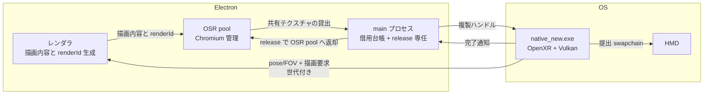
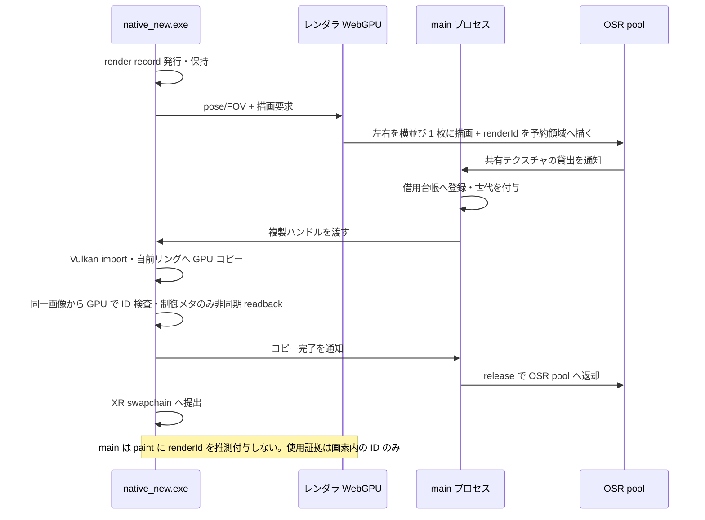
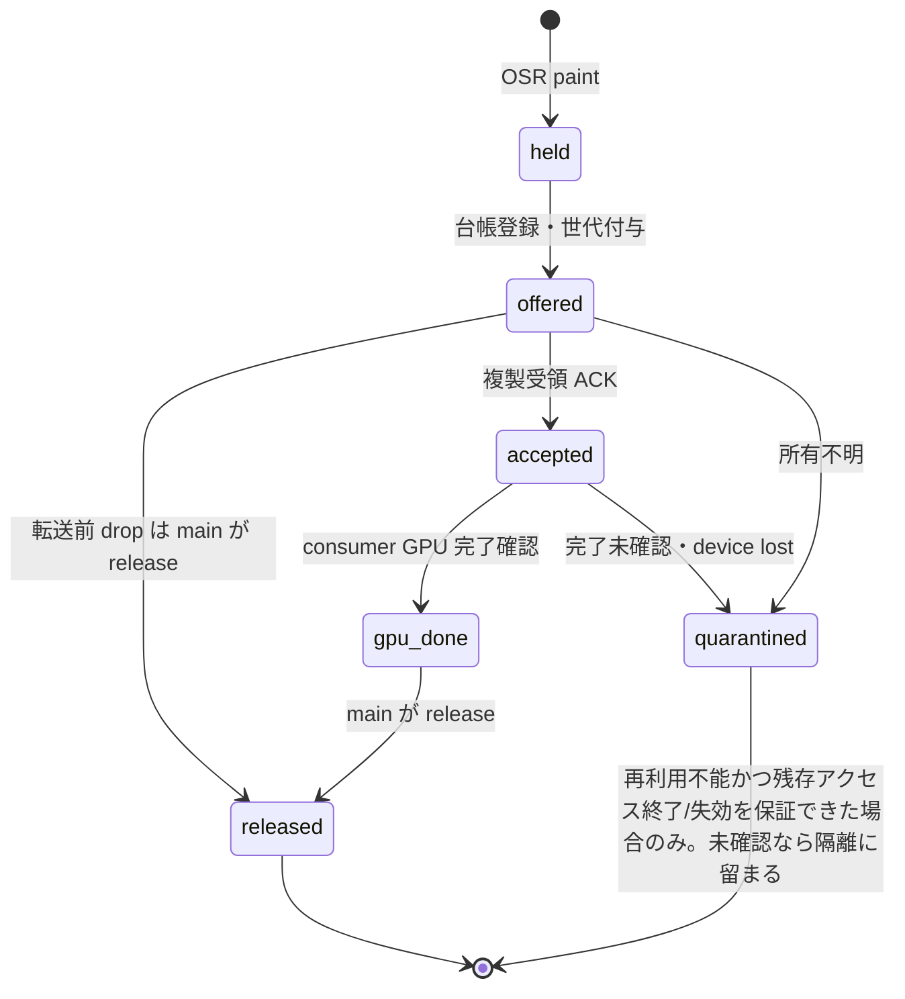

# native_new 設計

- 別プロセス `native_new.exe` で OpenXR + Vulkan を動かし、Electron からは GPU 内コピーのみでフレームを受け取る
- 本番 TypeScript の作り直しは M5。M1〜M4 の Electron 側は検証ハーネス
- 実機で確定した事実だけを土台にし、未検証は未検証と書く

## 1. 目的と前提

- 目的: Electron 描画を HMD に出す。経路上の CPU コピーを無くす
- 前提
  - グラフィクスは Vulkan のみ。D3D11 バインディングは使わない
  - XR の時計は Node のイベントループから独立させる
  - 転送は GPU 内コピーのみ。読み戻しは検証用途に限るが、renderId 照合用の小さな制御メタデータの非同期 readback だけを本番の例外とする（§7 参照）。XR ループを readback 待ちで止めない
  - Linux は将来対応。Windows 固有 API を共通境界へ漏らさない

## 2. 全体構成図

- 画像の実体は GPU メモリに留まる。プロセス間を動くのはハンドルと通知と世代 ID
- 描画要求の主体は exe（pose/FOV と要求を供給）、描画の主体はレンダラ、提出の主体は exe。main プロセスは提出に関与しない
- レンダラの描画資源（WebGPU 側）と OSR 出力テクスチャ（共有 pool）は別物。前者の寿命に後者を連動させない

## 3. 採用した構成と理由

- 採用: 別プロセス exe を維持し、main プロセスにはハンドル転送用の薄いアドオンと借用台帳だけ置く
- 理由
  - XR の時計を Node のイベントループから切り離せる
  - クラッシュの影響範囲が分かれる。レンダラ異常が XR セッションを道連れにしない
  - 既存 exe の再利用が効く。提出側と受信側を別々に進められる
  - Linux で FD 転送に差し替えるとき、境界が既にある
- 捨てた案
  - ① main 内アドオンで OpenXR も動かす: 転送は減るが障害分離を失う。要判断の同期問題と XR 安定性が同居する
  - ② レンダラ内アドオン: ハンドルの取得元とプロセスが違う。OSR paint は main プロセス側の概念
  - ③ 画面キャプチャ: CPU 経由に戻る。OSR 共有テクスチャで足りることが実測済み
  - ④ WebGPU テクスチャの直接エクスポート: 仕様・実装に存在しない。未検証ではなく不存在
  - ⑤ OpenXR を D3D11 でやる: 方針に反する。ただし将来のフォールバック候補としては記録する
  - ⑥ 画像が届くだけでネイティブ完成: 対応付け・借用管理・異常時停止が無い。現行のクリア表示 exe はこれに当たる。以後は完成と呼ばない

## 4. フレームの流れ

- 所有の考え方
  - OSR テクスチャと pool を管理するのは Electron/Chromium。借用オブジェクトと `release()` は main プロセスが保持し、呼ぶのは main プロセスだけ。借用ごとに台帳を持つ
  - レンダラは描画内容と renderId の整合性に責任を持つ。OSR 借用の返却は担当しない
  - exe は借用中の複製だけ扱う。所有権は取らない
- 台帳は接続世代と借用 ID で管理し、renderId とは分離する（同じ描画の複数 paint は別の借用）
- 転送前 drop は即返却可。転送後は consumer が今後使用しないと確定するまで main プロセスの独断で返却しない
- 受領前後の失敗で所有不明なら接続世代を終了して回収する

## 5. 画像の所有権と寿命

- main プロセスが遷移を直列化し、重複・遅延 ACK は無視する
- 状態は少なくとも `held → offered → accepted → GPU完了 → released` と `quarantined` を持つ
- 返却条件は「その借用画像への consumer の全 GPU アクセスが終了した証拠」。timeout・IPC 切断・プロセス終了通知は代用にならない
- 期限超過による返却は禁止。詳細は§6 の①②に従う

## 6. 異常時の返却・停止

- ① コピー完了を待てる場合: 新規受付と submit を止め、対象アクセスの完了を確認 → main プロセスへ完了通知 → main プロセスが `release()` → 資源と XR セッションを破棄して終了。期限超過時は②へ
- ② 完了を確認できない・device lost: 不確かな借用は `release()` しない。未使用画像のみ、新たなアクセスが起きないことを確定して返却する。main プロセスは旧 producer 世代を停止・隔離する。OSR 資源を再利用しうる Electron GPU process を含む所有系の終了が必要なら Electron 全体を終了する。consumer の終了だけで GPU 完了と扱わない。裏付けが無ければ隔離状態で自動復帰しない
- ③ producer が先に死んだ場合: 死んだ producer へ返却しない。consumer は新規使用を止め、完了確認できれば解放して終了、できなければ②と同じ経路。main プロセスも死ぬ場合に備え、監視と切断検知で双方の停止を成立させる
- 次回は新しい session/connection epoch・新しい pool・新しい HANDLE で開始し、旧 ACK・旧画像を受け付けない
- 外部から見て安全と言えるのは「アクセス完了後に返却済み」または「旧世代が再利用不能で残存 GPU アクセスの終了/失効を保証済み」のどちらか
- 棄却: 「異常なら返して終了」「CloseHandle や exe 終了をコピー完了とみなす」。どちらも GPU 完了の証拠にならない

## 7. pose と画像の対応付け

- exe が接続世代・空間世代・描画 ID を発行し、描画に使う左右 pose/FOV・予測時刻・viewport を変更不能なレコードとして保持する
- レンダラは実際に使用したレコードの ID を画像の予約領域へ描く。main プロセスは paint に推測の renderId を付けない
- exe は自前画像へコピーした後、同じ画像から GPU で ID を検査し、小さな制御メタデータだけ非同期 readback する（§1 の例外）
- ID 不明・checksum 不一致・記録失効・space 世代不一致・年齢上限超過は破棄する。繰り返し paint は同じ renderId として扱う
- ID が正しくても全画素の同期は保証しない（producer の書き込み完了問題は§8 で扱う）
- 既知の古い画像は元の pose/FOV と同じ座標系で提出し、ランタイムの再投影に任せてよい。最新 pose への付け替えは禁止する
- 対応不明の画像を再投影頼みで提出することは禁止する。最後に受理した画像は exe 所有の
  hold イメージへ GPU 複製し、新規受理が無いフレームでも同じ record の pose/FOV のまま
  出し直す（再提出。黒より古い絵を優先する）。最初の 1 枚が来る前だけ projection layer
  なしで frame を終える。`--no-resubmit` で旧挙動（空フレーム比較用）に戻せる。
  再提出の年齢上限は `--resubmit-max-age-ms` で別に付けられる（既定 0=無制限。
  新規受理の `--record-ttl-ms` とは別枠）。
- 年齢上限は `--record-ttl-ms` で設定でき、既定 500ms である。
  実測: 本番サイトで 350〜500ms の遅延のため、app 経由の通常運用は暫定 2s で渡す
- レコード発行のフロー制御（`--pace-records`。既定 off、app 経由の通常運用は on）
  - 未処理の画像がある間は新しいレコードを発行しない（RenderRequest を送らない）。
    Offer を処理（受理/棄却/中間破棄）し終えたら、次のフレームで新しいレコードを発行する
  - 応答が無いまま 500ms 経過したら、同じレコードの再送ではなく新しいレコードを
    発行して詰まらないようにする（古いレコードは TTL と掃除で失効させる）
  - `xrEndFrame` は従来どおり毎フレーム呼ぶ（最初の受理前の空フレームだけ layerCount=0、
    以後は新規受理か hold からの再提出のいずれかで層を出す）
  - app 側は未処理の Offer がある間の paint を stale として即返却する
    （`droppedStale`。`drops` と区別）。発行と消費を 1:1 に保つ
- 棄却: 描画要求 1 件制限だけ（重複・欠落との対応を証明できない）、paint の timestamp と要求時刻の近さ（使用 pose の証拠にならない）

## 8. 同期の保証範囲と未解決リスク

- 保証できること
  - 自分の GPU コピー完了まで `release()` を遅らせることで、読み終わる前の再利用は防げる
  - 読めた ID と保持レコードの対応は確認できる。画像全体と pose の一致は producer 同期の解決に依存する
- 保証できないこと
  - producer 側の描画完了・可視性。keyed mutex も共有 fence も無い
  - 照合済み画像の全画素が書き込み完了済みであること
  - 上流 issue は open のまま。要判断のまま進める
- 判定方法
  - フレーム番号帯の連番確認で破綻を早期検知する。全画素検査は重いので要所だけ
  - 破綻の見分け: 世代混在・ティアリング・古い画像の再利用
- 破綻時の選択肢（未決事項）
  - Electron に keyed mutex を戻すパッチを保守する
  - 上流対応まで製品化を止める
  - 破綻頻度次第で許容する
- 原則
  - timeout は返却許可ではない。期限切れで `release()` してよい理由にはならない
  - 無事故実測を同期証明の代用にしない。動いた回数は保証ではない

## 9. 両眼化と色

- 両眼化
  - Electron が左右の異なる視点を 1 枚の横並びアトラスに描く
  - native が左右領域を分離して各 eye に出す
  - pose/FOV は exe が供給元。対応付けは§7 の renderId 照合で行う
- サイズの扱い
  - `codedSize` は要求値と一致しない。実測で 512 要求が 513x514 になった（実測事実として残す）。決め打ちしない。来た値を正とする
  - `rowPitch=2176` は D3D11 STAGING を Map した値であり、Vulkan import のピッチとして使えない。行アクセス時は実測値を使う
- 色
  - 採用方針: UNORM 取り込み + シェーダで sRGB decode。単純 blit は二重符号化になり得る
  - 最終確認（出力形式・二重符号化の有無）は未決として残す

## 10. 入力・haptics・空間・ライフサイクル

- 対応範囲は現行実装の対応範囲を土台とする
- 入力の最低ライン（ネイティブ側で取得・無効化まで持つ）
  - 左右 grip/aim pose、trigger、squeeze、thumbstick＋click、primary/secondary、menu、haptic の開始・停止
  - trackpad＋click もデータ項目として維持する。削るのは入力項目ではなく、初期に実機保証する interaction profile
  - 現用 PICO の profile を最初に保証し、他機種（simple/oculus/index/vive/motion 等の既存 suggest 先）は未検証と明記する
- TS 側へ回すのは操作の意味付け・UI・デッドゾーン調整・追加機種の実機保証。入力取得・無効化・haptics 停止はネイティブ側に残す
- reference space
  - local/stage/local-floor の対応可否とフォールバック（現行: local-floor 要求→stage→local の順に後退）、明示変更を受け付ける
  - `REFERENCE_SPACE_CHANGE_PENDING` の適用時刻に従い、座標世代（spaceEpoch）を更新する。旧世代の render レコードは失効させる
- HMD 脱着・再接続・終了
  - 脱着は session loss とは限らない。focus/visibility/`shouldRender` に従って停止・復帰する
  - loss 時は安全に破棄し、新しい接続世代で再生成できることを完成条件に含める（§6 の epoch 更新と連動）

## 11. 段階計画

| 段階 | 作るもの | 動く証拠 | 未達なら何を疑うか |
|---|---|---|---|
| M1 | 別 exe・XR 指定 GPU への import、コピー、返却 | 実解像度横並び・90Hz で 10 分、全画面動的パターンの GPU 検査で破損・世代混在 0 件 | import 条件・GPU 選択・ハンドル複製 |
| M2 | pose/FOV と画像の厳密な対応、両眼提出 | 正常照合に加え、不明 ID・失効レコード・旧 space 世代の画像注入をすべて棄却し、左右分離が正しく、pose 付け替え無し | 世代管理・左右分離・提出側の時計 |
| M3 | 滞留制限、借用管理、正常終了・障害時停止 | §6 の①〜③を障害注入（consumer 強制終了・ACK 消失・producer 先死・device lost）で再現し、期待状態（隔離 or 返却済み）と観測結果が一致、高負荷でも枯渇なし | 上限値・返却タイミング・異常検知 |
| M4 | 入力、haptics、reference space 変更、HMD 脱着・再接続・終了 | 無効化（inactive/unsupported）と停止・復帰・再接続が期待どおりで、loss 後に新世代で再生成できる | アクション束縛・空間世代・状態遷移 |
| M5 | 本番 TypeScript の再実装・接続 | 実解像度で画像年齢・再投影率・色・操作の観測結果が基準内 | 実解像度性能・色・遅延 |

- M1〜M4 の Electron 側は検証ハーネス。本番 TS の作り直しは M5 で行う
- 「ネイティブ完成」= M1〜M4 をハーネスで検証済み、かつ同期の安全性（§8）を説明できる状態。実アプリとしての完成（M5）とは区別する
- 512² の 89fps は VR レイテンシの合格証拠ではない。実解像度で測り直す

## 12. リスク上位 3

- producer 同期: 描画完了の保証が無い。早期検知はフレーム番号帯の連番確認
- OSR 遅延と画像・pose 不一致: 古い画像に新しい pose が付く。早期検知は renderId 照合で捨てる
- GPU・外部画像の互換と寿命: import 条件・形式・返却漏れ。早期検知は import 失敗率とプール枯渇の監視

## 13. 未決事項

- 同期破綻時の方針: パッチ保守・製品化停止・頻度次第で許容のどれか
- 画像年齢上限・再投影率・性能合格値: 計測後に決めるが、M4 の完成判定までに固定する。
  現時点の実測は本番サイトで 350〜500ms の遅延のため TTL は暫定 2s（app が `--record-ttl-ms=2000` を渡す）
- 色の最終確認: 二重符号化の有無は要判断
- 追加 controller profile の保証範囲、Linux の輸送実装は後決めでよい
- 同期保証、旧世代の隔離、別 exe / XR 指定 GPU の import は未検証として残せるが、完成条件から除外しない
- 輸送の hot path に Windows の D3D11 `OpenSharedResource1` を置かない（実測で約 +16MB/分の増加が止まらないため。既定は Vulkan 経路）

## 実機で確定した事実

- Electron 44.9.0 の OSR 共有テクスチャで paint 120/120。実測 88〜89fps、paint 通知間隔 p50 11ms・p95 13ms（VR レイテンシではない）
- `handle.ntHandle` を main プロセスで取得。N-API アドオンが開けて画素一致
- 同一プロセス・同一 GPU・RTX 3090 での直接 import に成功。LUID 一致を確認
- 別 exe への複製と XR 指定 GPU での import は未検証（M1 の検証対象）
- ひな形 exe が SteamVR/OpenXR + RTX 3090 + PICO 4 で両眼クリアまで動作（§3⑥の通り完成証拠ではない）
- ランタイム指定の物理デバイスを使う方針で動いた

## 14. 既知の挙動

- XR セッション起動の繰り返しと終了（PICO/SteamVR で 6 サイクル、各 12 秒 VR → ウィンドウ close）
  - app/exe とも exit 0、close→終了 0.35〜0.59 秒、残存プロセスなし
- VRAM（nvidia-smi、MB）の実測
  - 起動前 5,341 → XR セッション 3 回で 7,650 → 6 回で 8,541（約 +300MB/起動）
  - SteamVR 停止で 8,544→4,146、再起動後 5,392（SteamVR 再起動で解放される）
  - Electron のみ（`--no-exe`）×3 では増加 0（5,341→5,340）。
    したがって Electron/OSR/ミラーは原因ではない
  - 約 300MB は 7144×1786×2眼×3バッファ ≒ 306MB（スワップチェーン 1 組）とほぼ一致する
- 原因候補: SteamVR コンポジタのアプリ別キャッシュ、またはクライアント終了時の解放遅延。
  回避策: 起動を繰り返したら SteamVR を再起動すること。深追いは未実施（M5 完了を優先）
